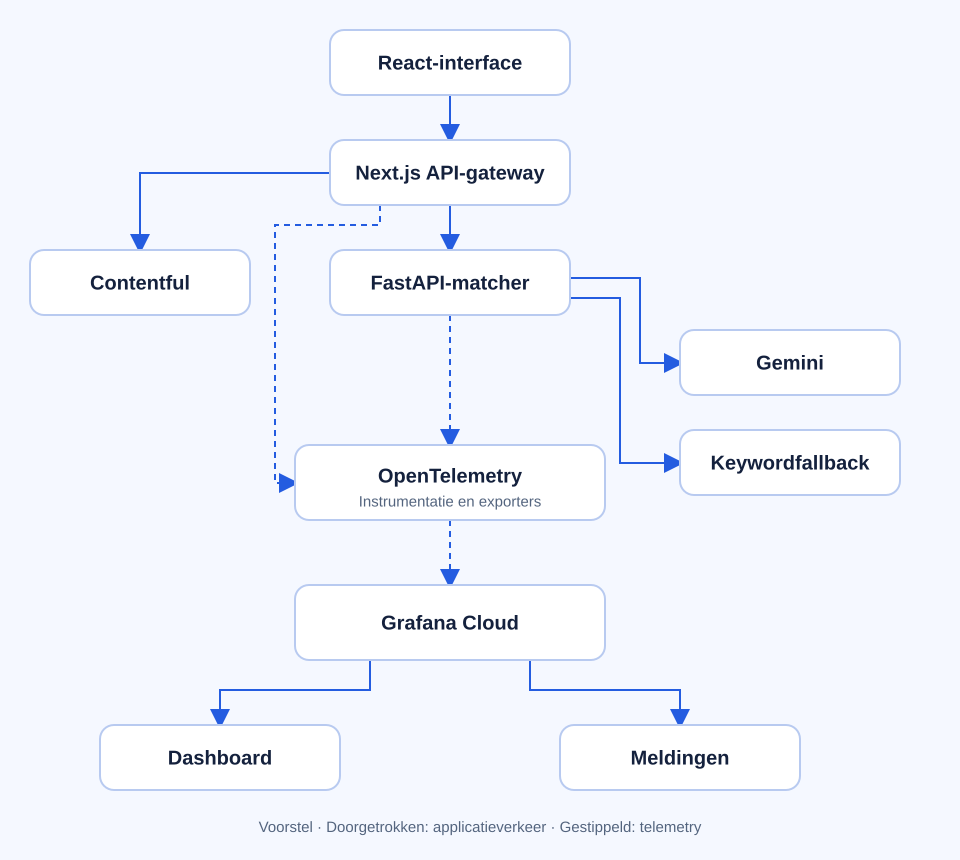
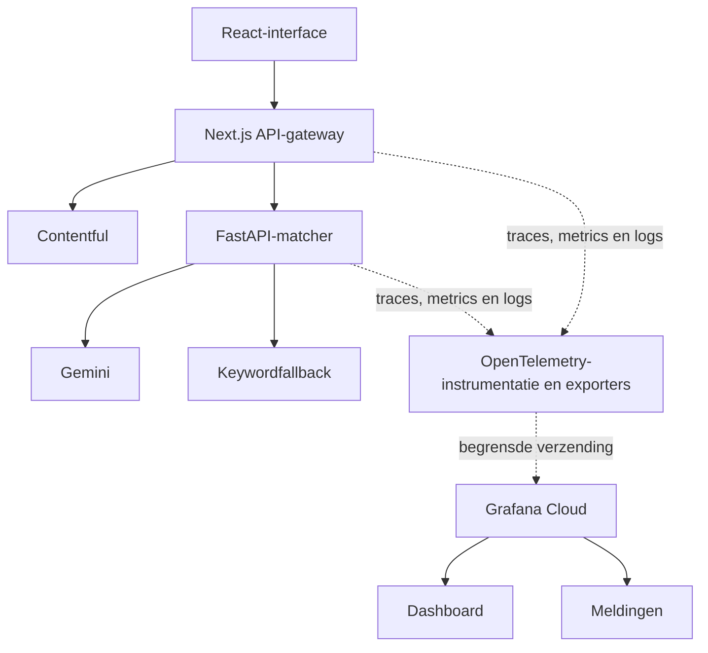

# Observability-architectuur: Next.js, FastAPI en Grafana

Status: voorstel. Grafana Cloud en OpenTelemetry zijn nog niet aangesloten. De bestaande applicatie heeft al technische foutlogs en request-ID's.

## Architectuurdiagram

De doorgetrokken lijnen tonen applicatieverkeer. De gestippelde lijnen tonen technische meetgegevens. OpenTelemetry is hier een logische laag: Next.js en Python krijgen ieder eigen instrumentatie en exporters, geen gedeeld proces dat alle aanvragen moet verwerken.

## Waarom deze architectuur?

De browser blijft dezelfde API gebruiken. Monitoring verzamelt informatie over de bestaande uitvoering, zonder de analyse afhankelijk te maken van Grafana. Het doel is te zien waar een probleem ontstaat, hoe vaak het voorkomt en of een wijziging verbetering oplevert.

Next.js meet validatie, rate-limiting, het ophalen van Contentful-data en de aanvraag naar Python. FastAPI meet wachttijd op capaciteit, analyse en de Gemini-aanvraag. Contentful en Gemini hoeven zelf geen Grafana-integratie te hebben: we meten onze eigen uitgaande aanvragen.

Next.js geeft W3C-tracecontext mee aan Python. Daardoor horen de spans van beide services bij één trace. De bestaande request-ID blijft bruikbaar voor foutlogs, maar vervangt tracecontext niet.

## Wat verzamelen we?

| Gegevens | Betekenis                                    | Voorbeeld                                                          |
| -------- | -------------------------------------------- | ------------------------------------------------------------------ |
| Metrics  | Aantallen en trends over meerdere aanvragen  | Succespercentage, responstijd, drukte, keywordfallbacks            |
| Traces   | De stappen en tijdsduur van één aanvraag     | Contentful ophalen → Python aanroepen → Gemini proberen → fallback |
| Logs     | Technische gebeurtenissen en foutcategorieën | `connection_refused`, time-out of `MATCHER_BUSY`                   |

Grafana Cloud kan deze gegevens opslaan en gezamenlijk weergeven. Een dashboard maakt onderscheid tussen website en backend, deployment en omgeving. Meldingen gebruiken aanhoudende problemen en voldoende aanvragen als basis, zodat één fout bij weinig verkeer geen misleidend alarmsignaal geeft.

## Voorbeeld van een diagnose

Een bezoeker start een analyse. De trace kan tonen dat Contentful snel antwoordt, Python op capaciteit wacht en Gemini vervolgens een time-out geeft. Keywordmatching levert alsnog een resultaat. Alleen het HTTP-succespercentage zou dit als een geslaagde aanvraag tonen; een fallbackmetric en trace maken de verslechterde AI-beschikbaarheid zichtbaar.

Dit is een illustratie van het gewenste inzicht, geen gemeten productie-trace.

## Privacy en betrouwbaarheid

- Verzamel geen vacaturetekst, prompts, modelantwoorden, tokens, cookies, e-mailadressen of IP-adressen.
- Gebruik een expliciete lijst toegestane attributen; automatische HTTP-instrumentatie moet gevoelige headers, querystrings en bodies uitsluiten.
- Request-ID's en trace-ID's horen in logs en traces, niet als metriclabels. Metriclabels gebruiken beperkte categorieën zoals service, omgeving, statusklasse en foutcategorie.
- Exporters krijgen korte time-outs, begrensde buffers en sampling. Falen van telemetry mag geen analyse laten mislukken.
- Credentials staan alleen in server-side omgevingsvariabelen. Lokale ontwikkeling moet zonder Grafana kunnen draaien.

## Implementatievolgorde

1. Controleer actuele Grafana Cloud-limieten, eventuele kosten en de exporterondersteuning voor Next.js en FastAPI op Vercel.
2. Voeg instrumentatie en tracecontext-propagatie toe aan beide services.
3. Voeg applicatiemetrics toe voor analyse-uitkomsten, capaciteit en providerfallback.
4. Test dat telemetry veilig blijft, geen inhoud lekt en de serverless export/flush ook bij korte requests werkt.
5. Maak één dashboard en stel passende meldingen in. Controleer de keten met een gecontroleerde fout.

Het startvoorstel is directe export naar Grafana Cloud. Een eigen collector kan later nuttig zijn voor centrale filtering of buffering, maar voegt een extra service toe om te beheren. De exacte exportstrategie moet eerst worden getest op Vercel; dit diagram beschrijft het ontwerp, niet een reeds werkende koppeling.

Zie [matcher reliability](matcher-reliability.md) voor de geïmplementeerde foutafhandeling, healthchecks en hersteltests.
